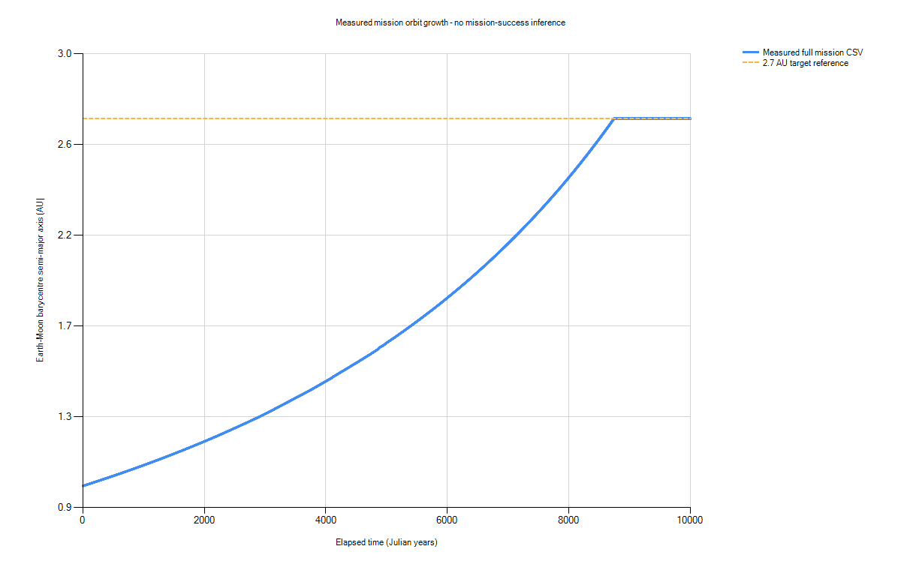

> Historical original-layout report. Current selected-design status: [stopped prefixes](../Results/STATUS.md) and [selected-design prefix report](Selected_Design_Prefix_Report.md). The selected design has not completed a full run.

# Tractor visibility and orbit-transfer diagnosis

Executed on 2026-10-25. No existing acceptance tolerance was changed. Primary evidence: Results/tractor_diagnosis.json, diagnosis_initial_audit.json, diagnosis_unity_regression.json and the full mission CSV/JSON.

## Failing layer

The headless trajectory grows. The visibility/motion failure was in presentation: the earlier inspection loaded only a separate 100-year diagnostic and replaced the recorded direction with a constant Earth-centred +X separation. It hid the Sun and the heliocentric trajectory. The separately selectable live M2 baseline contains no tractor propulsion and was not a mission run. Playback previously advanced sample indices, not a configurable simulation-time clock.

The corrected default view streams Results/mission_h3600_y10000/run_mission.csv and labels its exact source. It preserves Sun-relative double coordinates before float conversion, supports Sun / transfer and Earth + tractor views at the same time, and shows a visible enlarged tractor callout with a leader to the true CSV position. Earth-tractor close views preserve the recorded direction in inertial axes. The Sun, Earth and marker enlargement factors are labelled. Schematic thruster dimensions are not claimed as validated hardware. A gravitational pull direction arrow and a rolling two-orbit CSV trajectory are visible. The playback clock supports 1e9x and a full-duration year slider. Between samples, positions use Hermite display interpolation; a/thrust readouts use linear interpolation. No interpolated result is used for physics or gate acceptance.

## Full configured run

Command: dotnet Tools/HeadlessMission/OctoEarth.Cli.dll mission. Configured duration 10000 Julian years = 315576000000 s; fixed timestep 3600 s. Terminal time 10000 yr; completed=True; partialStep=False.
The recorded EMB semi-major axis reached 2.7 AU at 8742.17590691 yr. Terminal a_EMB=2.69913803664 AU.
Mission status: FAIL (provisional: placeholder thresholds). Terminal EMB eccentricity=0.020765601752. Reaching a semi-major-axis reference does not establish a circular, safe mission or WIN. Powered radial parking after the target is part of the configured implementation and its mass/power remain booked.

| Time (yr) | Earth heliocentric a (AU) | EMB a from CSV (AU) | Thrust (N) | mdot (kg/s) | All infrastructure ejecta (kg) |
|---:|---:|---:|---:|---:|---:|
| 0 | 1.00016825247 | 1.00000261 | 0 | 0 | 0 |
| 1 | 0.99952256691 | 1.00011137164 | 2.549388801E+17 | 937646436626 | 2.96536281671E+19 |
| 10 | 1.00022889298 | 1.00088633087 | 2.54941379249E+17 | 937655628310 | 2.96536386299E+20 |
| 100 | 1.00962610964 | 1.0090006029 | 2.54942325674E+17 | 937659109194 | 2.9653641532E+21 |
| 1000 | 1.09480831899 | 1.09573793657 | 2.54947081263E+17 | 937676599900 | 2.96536433793E+22 |
| 10000 | 2.70218273337 | 2.69913803664 | 2.5493815725E+17 | 937643778037 | 2.9653632109E+23 |

The exact 0/1/10/100/1000-year rows come from a second run of the same unmodified dynamics with additional read-only logging. Across all 12,176 shared records its original columns match the full run byte-for-byte. The final row comes from the full-duration CSV. Earth a uses GM_sun+GM_earth; the mission CSV a uses the Earth-Moon barycentre and GM_sun+GM_earth+GM_moon. Lunar motion gives Earth short-period variations; Earth a need not rise between every selected epoch. The initial thrust=0 row is written before the first command, not a guidance cutoff. mdot is derived from the recorded end-half-kick thrust divided by ve*cos(cant); measured cumulative ejecta includes tractor, array and mirror. End-half-kick thrust is not a step-average thrust.

Tractor mass=1.6104890015E+18 kg. Initial d=50000000 m; final recorded d=49999999.9997 m. Mass is replenished under E1; the tractor body mass is held finite and constant, while supplied/ejected material is booked. Initial resolved gravitational acceleration along Earth velocity=4.29955434581E-08 m/s^2; final=-5.81459639064E-10 m/s^2.
Tractor-only instantaneous EMB da/dt at t=0=9.15332324863E-05 AU/yr. Direct measured changes in a_EMB give first-year mean 0.000108761640223 AU/yr and first-100-year mean 8.99799290135E-05 AU/yr. The full N-body derivative includes planetary/lunar perturbations; it is not identical to the tractor-only energy derivative.

## Ordered force, units and control audit

1. Actual body list has 13 finite bodies, including tractor mass 1.6104890015E+18 kg. Its Earth-relative offset has cosine 1 with heliocentric EMB velocity.
2. Reciprocal pair gravity: Earth force 2.56776651005E+17 N toward tractor; tractor Earth-gravity acceleration 0.15944017672 m/s^2 toward Earth. Relative pair force imbalance 3.11554807211E-17. G1 also measures finite Earth velocity change with the solar contribution removed, rather than relying only on a formula evaluation.
3. Initial feedforward thrust 2.56765661495E+17 N, outward-direction cosine 0.999999999935. Gravity + command - prescribed acceleration residual 1.0012300347E-17 m/s^2. Exhaust uses the opposite thrust direction in both canted streams. G1/G2 exercise the actual booked kicks; initial feedforward magnitude differs slightly from the discrete Mode B end-half-kick diagnostic.
4. ve=300000 m/s; d in metres; mass in kg; dt=3600 s; duration=315576000000 s. No km/s or year/second substitution.
5. Initial a_EMB=1.00000261 AU; cutoffAtStart=False. Cutoff compares SI semi-major axis to 403914250890 m (2.7 AU).
6. Initial array area 1.09516103016E+20 m^2 supplies 4.47208940543E+22 W electrical versus initial tractor feedforward jet demand 4.24964341861E+22 W. E1 cap 3E+23 kg; terminal material used 2.96537416351E+23 kg. Actual resource/stop flags are listed below, without changing limits.
7. Earlier viewer coverage was only 100 years; this command requested 10000 years. Terminal duration and completion state are reported above.
8. Mode B recomputes its target each step. On a cloned initial full state, the one-step prescribed target moves 109013648.914 m; it is not a fixed world-space location. The actual logged hover separation and G2 impulse comparison validate the running solver.

## Ledger and flags

Full-run maxima: relative P=6.23498212925E-13, L=1.12804534877E-12, E=7.55742060769E-12, actual-kick mismatch=5.1739255698E-12, reaction closure=6.63385061329E-16. Mechanical acceptance remains 1e-9. See mission ledger.txt for solar energy-sector closure. Minimum illustrative structural factor=0.0920971794021; temperature range=288..291.811764818 K; maximum shading=1.

- FocusingOpticsUnresolved at 0 yr: Giant focusing optics remain outside E1-E3 pending organiser confirmation.
- MaterialStrengthUnvalidated at 0 yr: Rock and frame strength inputs are illustrative engineering assumptions, not validated components.
- ThermalStructuralModelIncomplete at 0 yr: Local beam/column checks omit coupled thermal deformation and global optical stability.
- StructuralSafety at 0 yr: A modeled component safety factor is below 1.5; rock/frame assumptions do not imply unlimited strength.
- InitiallyInwardEjecta.Tractor at 0.000114077116131 yr: An unintegrated parcel is not initially radially outbound; ballistic future escape is not assumed.
- TractorTides at 0.0193931097422 yr: Tractor tide gradient exceeds placeholder Moon-relative threshold.
- PlumeIntersection.Tractor.Array at 59.0930869268 yr: Plume cone or exclusion zone intersects target.
- FluxCap at 62.9822039699 yr: Received visible plus array waste-heat flux exceeds placeholder limit.
- PlumeIntersection.Mirror.Array at 63.9649783253 yr: Plume cone or exclusion zone intersects target.
- ArrayShading at 63.983344741 yr: Array overlaps Sun as seen from Earth or mirror beyond threshold.
- PlumeIntersection.Array.Mirror at 307.496805841 yr: Plume cone or exclusion zone intersects target.
- PlumeHeating.Array at 1246.06593657 yr: Gaussian plume irradiance on Earth's near limb exceeds threshold.
- PlumeIntersection.Array.Moon at 1246.06650696 yr: Plume cone or exclusion zone intersects target.
- PlumeIntersection.Array.Earth at 1313.97330595 yr: Plume cone or exclusion zone intersects target.

## Fresh acceptance reruns and viewer verification

### G1
| Check | Measured | Expected | Unchanged tolerance | Result |
|---|---:|---:|---:|---|
| G1.h60.duration | 2592000 | 2592000 | 0 | PASS |
| G1.h60.distance | 0.000475131791429 | 0 | 0.001 | PASS |
| G1.h60.acceleration | 5.79363066874E-06 | 0 | 0.001 | PASS |
| G1.h60.P | 1.10738462001E-14 | 0 | 1E-09 | PASS |
| G1.h60.L | 3.85252500954E-14 | 0 | 1E-09 | PASS |
| G1.h60.E | 7.68167720115E-14 | 0 | 1E-09 | PASS |
| G1.h60.impulse | 4.27437422669E-13 | 0 | 1E-09 | PASS |
| G1.h60.reaction | 4.07834630328E-16 | 0 | 1E-09 | PASS |
| G1.h30.duration | 2592000 | 2592000 | 0 | PASS |
| G1.h30.distance | 0.000238364328365 | 0 | 0.001 | PASS |
| G1.h30.acceleration | 7.58421557491E-06 | 0 | 0.001 | PASS |
| G1.h30.P | 1.94416289363E-14 | 0 | 1E-09 | PASS |
| G1.h30.L | 3.4163901028E-14 | 0 | 1E-09 | PASS |
| G1.h30.E | 6.83299331774E-14 | 0 | 1E-09 | PASS |
| G1.h30.impulse | 8.52479407093E-13 | 0 | 1E-09 | PASS |
| G1.h30.reaction | 4.08122438398E-16 | 0 | 1E-09 | PASS |
| G1.halfstep | 4.95281545475E-05 | 0 | 0.001 | PASS |

### G2 (300 s)
| Check | Measured | Expected | Unchanged tolerance | Result |
|---|---:|---:|---:|---|
| G2.deltaV | 0.00460514876473 | 0 | 0.01 | PASS |
| G2.aDifference | 619990.801788 | 0 | 149597870700 | PASS |
| G2.eDifference | 4.48802524589E-08 | 0 | 1 | PASS |
| G2.A.P | 1.10409595363E-13 | 0 | 1E-09 | PASS |
| G2.A.L | 7.10881967078E-14 | 0 | 1E-09 | PASS |
| G2.A.E | 3.20847939511E-13 | 0 | 1E-09 | PASS |
| G2.A.kick | 1.11333585367E-13 | 0 | 1E-09 | PASS |
| G2.A.reaction | 4.46071531917E-16 | 0 | 1E-09 | PASS |
| G2.A.Moon | 1 | 1 | 0 | PASS |
| G2.B.P | 1.78871070122E-13 | 0 | 1E-09 | PASS |
| G2.B.L | 1.14018734816E-13 | 0 | 1E-09 | PASS |
| G2.B.E | 2.12347737228E-13 | 0 | 1E-09 | PASS |
| G2.B.kick | 1.07387220886E-13 | 0 | 1E-09 | PASS |
| G2.B.reaction | 4.76807740153E-16 | 0 | 1E-09 | PASS |
| G2.B.Moon | 1 | 1 | 0 | PASS |

### G3 (3600 s)
| Check | Measured | Expected | Unchanged tolerance | Result |
|---|---:|---:|---:|---|
| G3.a.sample1 | -0.00154630089016 | 0 | 0.02 | PASS |
| G3.a.sample2 | -0.00346386995025 | 0 | 0.02 | PASS |
| G3.a.sample3 | -0.00590465888979 | 0 | 0.02 | PASS |
| G3.a.sample4 | -0.00911662980745 | 0 | 0.02 | PASS |
| G3.targetTime | 0.00718740873831 | 0 | 0.05 | PASS |
| G3.e | 0.000112243986806 | 0 | 0.1 | PASS |
| G3.P | 1.27226044878E-12 | 0 | 1E-09 | PASS |
| G3.L | 8.80447342983E-13 | 0 | 1E-09 | PASS |
| G3.E | 1.08500970326E-12 | 0 | 1E-09 | PASS |

### G3 (1800 s)
| Check | Measured | Expected | Unchanged tolerance | Result |
|---|---:|---:|---:|---|
| G3.a.sample1 | -0.000377014748069 | 0 | 0.02 | PASS |
| G3.a.sample2 | -0.000845472274267 | 0 | 0.02 | PASS |
| G3.a.sample3 | -0.00144323220763 | 0 | 0.02 | PASS |
| G3.a.sample4 | -0.00223239603631 | 0 | 0.02 | PASS |
| G3.targetTime | 0.0017414122747 | 0 | 0.05 | PASS |
| G3.e | 0.000112866502931 | 0 | 0.1 | PASS |
| G3.P | 1.72592692538E-12 | 0 | 1E-09 | PASS |
| G3.L | 3.04240442027E-12 | 0 | 1E-09 | PASS |
| G3.E | 3.98663813952E-12 | 0 | 1E-09 | PASS |

32/32 fast Unity tests passed through MCP (job 393a7ced54164a4bb2f49d49f534546f). Two viewer regressions passed after presentation refinements (job f8eb6d82c99f4e20b3320b833f8e5a4a) and again after adding script-reload cache recovery (job f1709406f80c4b5a9bbecec1e8a1bffc: succeeded, two completed, no failures; its per-test result payload was unavailable after reload). The fixture initially failed because Unity Test Runner uses an unsaved scene; the isolated-object fixture was corrected without changing any assertion or physics tolerance. That failure is preserved in diagnosis_viewer_fixture_initial_failure.json. A live-file sharing error was fixed using a read-only FileStream with FileShare.ReadWrite. Editing a script during Play exposed lost parsed recording state; LateUpdate now reloads that cache before rendering, with an exact-count recovery assertion.

The viewer regression measured a quarter-year Earth displacement of 28.52745 Unity units (old fixed-origin inspection: zero). It checks exact CSV-to-display coordinates, Sun visibility, unchanged playback time between views, 1e9 simulated seconds per real second, endpoint clamping and unchanged baseline physics. Actual MCP Play-mode inspection measured the local quarter-year tractor position as (1.58, 0, -7.84) units, instead of the old fixed (8,0,0), and confirmed the M2 baseline clock is paused, the same Earth is retained, the full mission filename is loaded and the playback advances exactly 1e9 seconds from a one-second clock input. Game View screenshots verify Sun/tractor marker visibility and the close view. Headless acceptance was run by CLI, not through MCP; no live 10,000-year mission integration in Unity or xUnit SDK run is claimed. G4/G8 remain unaccepted; this task does not bypass their separate gates.

## Source files changed

- Assets/Scripts/Core/MissionRecording.cs
- Assets/Scripts/Core/MissionDiagnosticAudit.cs
- Assets/Scripts/Core/MissionSimulation.cs
- Assets/Scripts/Runtime/TractorInspection.cs
- Assets/Scripts/Editor/TractorViewSetup.cs
- Assets/Scenes/OctoEarth_Main.unity
- Assets/Tests/EditMode/CoreTests.cs
- Assets/Tests/EditMode/MissionViewerTests.cs
- Assets/Tests/EditMode/OctoEarth.Tests.EditMode.asmdef
- Tools/OctoEarth.Cli/Program.cs
- Tools/Diagnose-Mission.ps1
- Tools/Plot-MissionDiagnosis.ps1
- Tools/Write-DiagnosisReport.ps1
- Tools/Update-GateReport.ps1
- README.md
- LOG.md
- Docs/M3_Design.md
- Docs/Tractor_Diagnosis.md

Unity also generated .meta files for the two new Core scripts and MissionViewerTests.cs. The full mission CSV/JSON/ledger/final-state/enabler outputs, checkpoint run, rerun gate evidence, diagnosis JSON, Unity test reports, static plot and Game View captures are generated evidence. Physics integration, forces, guidance, resource limits, initial conditions and acceptance tolerances were not altered; MissionSimulation changes expose a cloned audit state and add read-only checkpoint/diagnostic logging.

